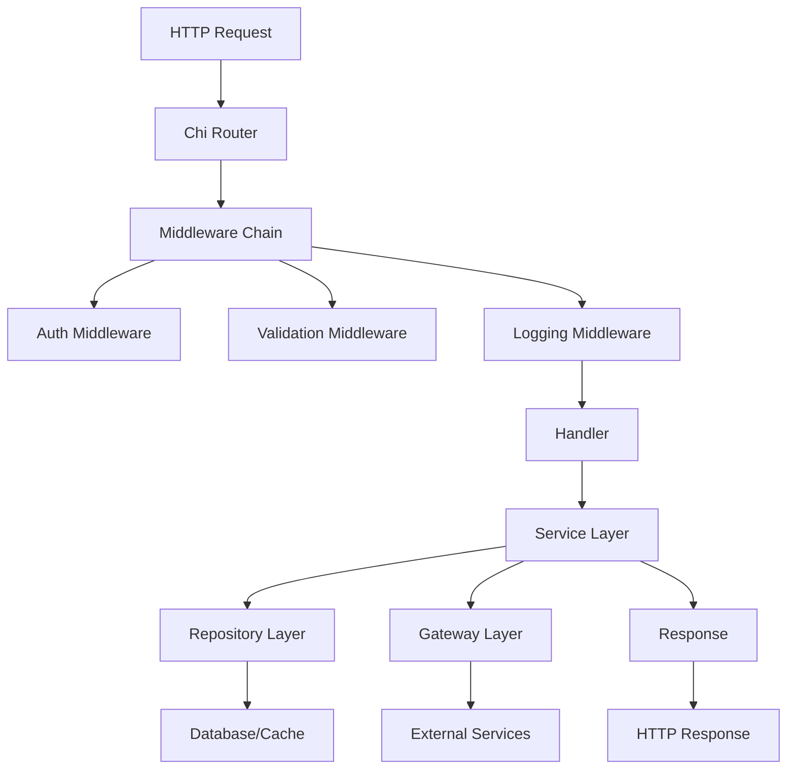

# Architecture Documentation

This document provides an in-depth overview of the Larsa Academy Microservice architecture, design patterns, and system components.

## 🏗️ System Architecture

### High-Level Overview

The Larsa Academy Microservice follows a **Clean Architecture** pattern with clear separation of concerns and dependency inversion principles.

```
┌─────────────────────────────────────────────────────────────┐
│                    HTTP Layer (Chi Router)                  │
├─────────────────────────────────────────────────────────────┤
│                     Middleware Layer                        │
│  ┌─────────────┐ ┌─────────────┐ ┌─────────────────────────┐ │
│  │    Auth     │ │  Validation │ │       CORS/Logging      │ │
│  └─────────────┘ └─────────────┘ └─────────────────────────┘ │
├─────────────────────────────────────────────────────────────┤
│                     Service Layer                           │
│  ┌─────────────┐ ┌─────────────┐ ┌─────────────────────────┐ │
│  │   Gateway   │ │  Messaging  │ │    Domain Services      │ │
│  └─────────────┘ └─────────────┘ └─────────────────────────┘ │
├─────────────────────────────────────────────────────────────┤
│                   Repository Layer                          │
│  ┌─────────────┐ ┌─────────────┐ ┌─────────────────────────┐ │
│  │   MongoDB   │ │    Redis    │ │        NATS             │ │
│  └─────────────┘ └─────────────┘ └─────────────────────────┘ │
└─────────────────────────────────────────────────────────────┘
```

## 📦 Package Structure

### Core Packages

#### `/pkg/api`
**Purpose**: HTTP server setup and routing configuration
- Initializes the Chi router
- Sets up middleware chain
- Configures CORS and compression
- Manages service initialization order

#### `/pkg/services`
**Purpose**: Business logic organized by domain
- Contains domain-specific business logic and operations
- Each domain is a separate package with its own models, repos, and handlers
- Uses generic repository pattern with `MainRepo[T]` interface
- Dependency injection setup per domain

Structure:
```
services/
├── contact/          # Contact management domain
│   ├── di/           # Dependency injection setup
│   ├── enums/        # Domain enums (StudentStatus, etc.)
│   ├── handler/      # HTTP handlers
│   ├── models/       # Domain models and DTOs
│   ├── repo/         # Repository implementations
│   ├── student.go    # Student service implementation
│   ├── teacher.go    # Teacher service implementation
│   └── parent.go     # Parent service implementation
├── messaging/        # Messaging domain (emails, notifications)
│   ├── di/
│   ├── models/
│   ├── repo/
│   └── messaging.go
├── db/              # Database utilities and shared operations
│   ├── di/
│   ├── models/
│   ├── repo/
│   └── sorting.go   # Sorting and sequencing utilities
```

#### `/pkg/gateway`
**Purpose**: External service communication
- Handles communication with other microservices
- Provides abstraction for external APIs
- Manages service discovery and load balancing

#### `/pkg/middleware`
**Purpose**: HTTP middleware components
- `auth.go`: Authentication and authorization
- `capability-check.go`: Permission validation
- Other cross-cutting concerns

#### `/pkg/types`
**Purpose**: Domain models and shared types
- `models.go`: Core domain models
- `appcgf.go`: Application configuration types
- DTOs and value objects

#### `/pkg/helpers`
**Purpose**: Utility functions and helpers
- `response.helper.go`: HTTP response formatting
- `errors.helper.go`: Error handling utilities
- `validation.helper.go`: Input validation helpers

## 🔧 Design Patterns

### 1. Dependency Injection

The project uses `github.com/samber/do` for dependency injection, providing:
- **Loose coupling** between components
- **Easy testing** with mock implementations
- **Clear dependency management**

**Pattern Implementation:**
```go
// Service registration in DI container
func Init(i *do.Injector) *do.Injector {
    do.Provide(i, NewYourService)
    do.Provide(i, repo.NewYourRepository)
    return i
}

// Service constructor with dependencies
func NewYourService(i *do.Injector) (*YourService, error) {
    repo := do.MustInvoke[YourRepository](i)
    gateway := do.MustInvoke[Gateway](i)
    
    return &YourService{
        repo:    repo,
        gateway: gateway,
    }, nil
}
```

### 2. Repository Pattern

Uses a generic base repository pattern with `MainRepo[T]` interface:

```go
// Base repository interface (from pkg/services/db/repo/main.repo.go)
type MainRepo[T any] interface {
    GetByFilter(ctx context.Context, filter bson.M) (*T, error)
    Aggregate(ctx context.Context, pipeline any, callback func(cur *mongo.Cursor) error) error
    Add(ctx context.Context, data *T, opts ...*options.InsertOneOptions) error
    AddMany(ctx context.Context, data []any, opts ...*options.InsertManyOptions) error
    Patch(ctx context.Context, filter, update bson.M, ops ...*options.FindOneAndUpdateOptions) (*T, error)
    BulkWrite(ctx context.Context, writeOps []mongo.WriteModel) (*mongo.BulkWriteResult, error)
    Count(ctx context.Context, filter any, opts ...*options.CountOptions) (int64, error)
    DeleteMain(ctx context.Context, filter bson.M) error
}

// Domain-specific repository extends base
type StudentRepo interface {
    MainRepo[models.Student]
}

// Implementation embeds generic implementation
type studentrepo struct {
    MainRepoImpl[models.Student]
}
```

**Benefits:**
- Generic CRUD operations with type safety
- MongoDB-specific operations (aggregation, bulk writes)
- Consistent database access patterns
- Context-aware database name resolution

### 3. Service Layer Pattern

Domain-focused services with specific interfaces:

```go
// Service interface defines domain operations
type StudentSvcs interface {
    Get(ctx context.Context, skip, limit int64, query *query.Conditions) (*models.StudentsPagination, error)
    Add(ctx context.Context, data *models.StudentDto) (*models.Student, error)
}

// Service implementation with repository dependency
type studentSvcs struct {
    repo repo.StudentRepo
}

// Constructor using DI container
func NewStudentSvcs(i *do.Injector) (StudentSvcs, error) {
    return &studentSvcs{
        repo: do.MustInvoke[repo.StudentRepo](i),
    }, nil
}

// Business logic implementation
func (s *studentSvcs) Add(ctx context.Context, data *models.StudentDto) (*models.Student, error) {
    // Get app config from context
    cfg, err := util.GetReqAppCfg(ctx)
    if err != nil {
        return nil, err
    }

    // Create domain entity
    student := &models.Student{
        Id:         primitive.NewObjectID(),
        StudentDto: *data,
        CreatedAt:  time.Now(),
        CreatedBy:  cfg.User.Id,
        UpdatedAt:  time.Now(),
        UpdatedBy:  cfg.User.Id,
    }

    // Persist using repository
    if err = s.repo.Add(ctx, student); err != nil {
        return nil, err
    }

    return student, nil
}
```

## 🔄 Data Flow

### Request Lifecycle

1. **HTTP Request** arrives at Chi router
2. **Middleware Chain** processes request (auth, validation, logging)
3. **Handler** extracts request data and calls service
4. **Service Layer** applies business logic
5. **Repository Layer** handles data persistence
6. **Response** is formatted and returned



## 🗄️ Database Architecture

### MongoDB Integration

**Connection Management:**
- Connection pooling with automatic retry
- Transaction support for multi-document operations
- Optimistic locking for concurrent updates

**Collection Design:**
```go
type BaseModel struct {
    ID        primitive.ObjectID `bson:"_id,omitempty" json:"id"`
    CreatedAt time.Time          `bson:"created_at" json:"created_at"`
    UpdatedAt time.Time          `bson:"updated_at" json:"updated_at"`
    DeletedAt *time.Time         `bson:"deleted_at,omitempty" json:"deleted_at,omitempty"`
}
```

### Redis Caching Strategy

**Cache Patterns:**
- **Look-aside**: Check cache first, then database
- **Write-through**: Update cache and database simultaneously
- **TTL-based expiration**: Automatic cache invalidation

## 📨 Message Queue Architecture

### NATS Streaming Integration

**Event-Driven Communication:**
- Asynchronous message processing
- Event sourcing for audit trails
- Service decoupling through events

**Message Flow:**
```go
// Publishing events
func (s *Service) PublishEvent(event Event) error {
    return s.nats.Publish("subject.event", event)
}

// Subscribing to events
func (s *Service) SubscribeToEvents() error {
    return s.nats.Subscribe("subject.*", s.handleEvent)
}
```

## 🔐 Security Architecture

### Authentication Flow

1. **Token Validation**: JWT tokens validated by auth middleware
2. **User Context**: User information stored in request context
3. **Authorization**: Capability-based permission checking

```go
// Protected endpoint
r.With(middleware.Auth("required_capability")).
    Post("/protected", handler.ProtectedEndpoint)

// Optional auth endpoint
r.With(middleware.OptionalAuth()).
    Get("/public", handler.PublicEndpoint)
```

### Security Headers

- CORS configuration for cross-origin requests
- Security headers for XSS protection
- Request size limits and timeouts

## 🚀 Performance Considerations

### Optimization Strategies

1. **Database Indexes**
   - Compound indexes for complex queries
   - TTL indexes for automatic cleanup
   - Sparse indexes for optional fields

2. **Caching Strategy**
   - Redis for frequently accessed data
   - Application-level caching for computed results
   - Cache invalidation strategies

3. **Connection Pooling**
   - MongoDB connection pool tuning
   - Redis connection pooling
   - HTTP client connection reuse

### Monitoring and Observability

**Key Metrics:**
- Response time percentiles
- Error rates by endpoint
- Database query performance
- Cache hit rates
- Memory and CPU usage

## 🔄 Service Communication

### Internal Communication

**Synchronous:**
- HTTP REST APIs for real-time operations
- Direct database access for data consistency

**Asynchronous:**
- NATS Streaming for event notifications
- Message queues for background processing

### External Communication

**Gateway Pattern:**
```go
type Gateway interface {
    GetUserData(userID string) (*User, error)
    SendNotification(notification Notification) error
    ValidatePermissions(userID string, resource string) (bool, error)
}
```

## 📋 Configuration Management

### Environment-Based Configuration

```go
type Config struct {
    Port        string `env:"PORT" default:"3278"`
    DatabaseURL string `env:"MONGODB_URI" required:"true"`
    RedisURL    string `env:"REDIS_URL" required:"true"`
    NatsURL     string `env:"NATS_URL" required:"true"`
    IsLocal     bool   `env:"IS_LOCAL" default:"false"`
}
```

### Service Discovery

- Environment variable-based service URLs
- Health check endpoints for service monitoring
- Graceful shutdown handling

## 🧪 Testing Architecture

### Testing Layers

1. **Unit Tests**: Service logic and business rules
2. **Integration Tests**: Database and cache operations
3. **API Tests**: End-to-end endpoint testing

### Test Doubles

```go
// Mock repository for unit testing
type MockRepository struct {
    data map[string]*Entity
}

func (m *MockRepository) GetByID(ctx context.Context, id string) (*Entity, error) {
    entity, exists := m.data[id]
    if !exists {
        return nil, ErrNotFound
    }
    return entity, nil
}
```

## 🔧 Deployment Architecture

### Containerization

**Multi-stage Docker build:**
1. **Builder stage**: Compile Go binary
2. **Runtime stage**: Minimal base image with binary

### Environment Separation

- **Development**: Local development with hot reload
- **Staging**: Production-like environment for testing
- **Production**: Optimized for performance and reliability

---

This architecture provides a solid foundation for scalable, maintainable microservice development while following Go best practices and clean architecture principles.
